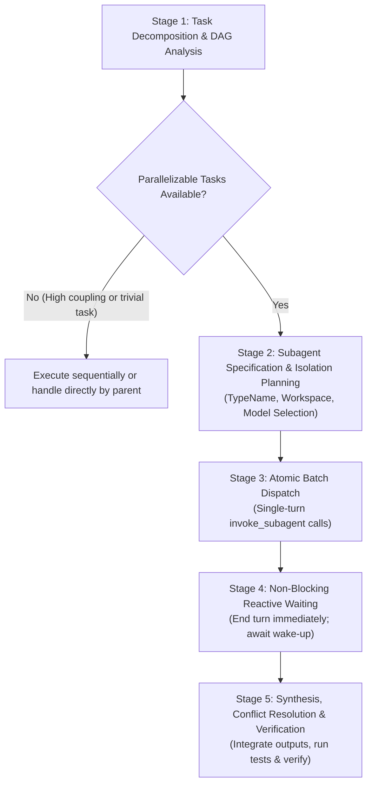

# Parallel Subagent Dispatch

This skill provides a systematic operational framework to **analyze current work items**, **identify parallel boundaries**, **configure workspace isolation and model tiers**, and **dispatch independent tasks concurrently across multiple subagents** in a single turn, followed by unified synthesis and global verification.

---

## Core Principles

1. **Zero-Polling Reactive Wakeup**:
   - The environment provides native reactive wakeup. When subagents finish execution or send messages, the parent agent is automatically resumed.
   - The parent agent **MUST NEVER** use busy loops (e.g., `while True`, `sleep`, or repeated manual status polling).
   - All ready, independent subagents must be launched in a **single turn** using multiple `invoke_subagent` calls, after which the turn terminates immediately to await notification.
2. **Boundary & Workspace Isolation**:
   - Only strictly independent tasks (nodes residing at the same level of the DAG without shared dependencies) may be parallelized.
   - If tasks involve file modifications, enforce strict file-level responsibility separation or use `Workspace: "branch"` to prevent write collisions in shared workspaces.
3. **Contract-Driven Prompts**:
   - Every subagent prompt must specify an unambiguous **Objective**, **Scope & Inputs**, **Explicit Guardrails & Non-Goals**, and **Expected Return Format**.
4. **Enforce Global Rules & Guardrails**:
   - All subagents inherit the repository's global rules (e.g., strictly no unauthorized modifications to build files like `CMakeLists.txt` or `Makefile`, no temporary files in `/tmp`—must use `.agent_scratchpad/`, zero-allocation rules in tight computational loops).

---

## 5-Stage Operational Protocol



---

### Stage 1: Task Decomposition & DAG Analysis

Before dispatching subagents, decompose all work items into a Directed Acyclic Graph (DAG) and evaluate parallel speedup versus coordination overhead:

1. **Construct the Task DAG**:
   - **Independent Read-Only / Research Tasks**: Zero write dependencies. Highest priority for parallel dispatch (e.g., surveying multiple modules, comparative log analysis, doc lookups).
   - **Independent Write / Implementation Tasks**: Tasks modifying strictly disjoint sets of files. Parallelizable with isolated file scopes or `branch` workspaces.
   - **Sequential / Dependent Tasks**: Tasks that require upstream deliverables or modify shared global state. **MUST NOT** be dispatched until prerequisites are fully resolved.
2. **Overhead vs. Speedup Assessment**:
   - Trivial tasks requiring only 1–2 quick tool calls (< 10 seconds) should be executed directly by the parent agent to avoid subagent startup and context-switching overhead.
   - Ideal workloads: Multi-file code surveys, independent component refactorings, batch log/metric parsing, parallel test failure isolation.

---

### Stage 2: Subagent Specification & Isolation Planning

Select the appropriate `TypeName`, `Workspace`, and `Model` based on task properties:

| Task Characteristics | Recommended TypeName | Recommended Workspace | Recommended Model | Typical Scenarios |
| :--- | :--- | :--- | :--- | :--- |
| **Read-Only Code Survey / Architecture Analysis** | `research` | `inherit` | `flash` or `flash_lite` | Cross-directory symbol trace, log statistics, documentation review |
| **Deep Algorithmic Derivation / Profiling** | `research` or `self` | `inherit` | `inherit` or `pro` | Filter math derivation, complex bottleneck root-cause analysis |
| **Independent Module Feature / Refactoring** | `self` | `branch` (preferred) or disjoint `inherit` | `inherit` | Developing decoupled subsystems without risking parent working tree state |
| **Isolated Unit Test Authoring & Execution** | `self` | `inherit` | `inherit` | Writing dedicated test suites for separate modules and executing `pytest` |
| **Specialized Repetitive Operations** | Custom (`define_subagent`) | Per requirement | Per requirement | Tasks requiring tailored SystemPrompts and specific tool permissions |

> [!IMPORTANT]
> - Under `Workspace: "inherit"`, **NEVER** assign two concurrent subagents to edit the same file.
> - If tasks touch overlapping files or have unknown global side effects, **ALWAYS** use `Workspace: "branch"`.

For the complete decision matrix, consult [references/concurrency-matrix.md](references/concurrency-matrix.md).

---

### Stage 3: Atomic Batch Dispatch

The parent agent must dispatch all independent subagents within **a single conversational turn**.

#### Standard Subagent Contract Template
Every subagent prompt must adhere to the 4-pillar contract structure:

```markdown
[OBJECTIVE]:
  State the core objective and exact deliverable clearly.

[SCOPE & INPUTS]:
  - Target files / directories: [Explicit paths, e.g., src/network/parser.cpp]
  - Context & Prerequisites: [Key background or reference parameters]

[GUARDRAILS & PROHIBITIONS]:
  - Out of bounds: [Explicit files/modules off-limits, e.g., do not touch CMakeLists.txt or src/sensor/]
  - Global rules compliance:
    - Strictly forbidden to write to /tmp; all temporary files MUST reside in .agent_scratchpad/.
    - Follow high-performance zero-allocation guidelines in hot loops.
    - Do not automatically git commit or stage changes.

[EXPECTED DELIVERABLE]:
  - Provide a concise summary of findings/changes with full file:// paths and line numbers.
  - Return test execution logs or artifact paths upon completion.
```

For production-ready prompt templates, consult [references/prompt-templates.md](references/prompt-templates.md).

---

### Stage 4: Non-Blocking Reactive Waiting

- Once all `invoke_subagent` calls are executed in the current turn, **end the turn immediately**. Do not run sleeps or status checks.
- When any subagent finishes or sends a message, the system triggers a Reactive Wakeup, resuming parent execution automatically.
- If a subagent requests guidance or clarification, use `send_message` with its `ConversationId` to respond; otherwise, collect responses until all assigned subagents report back.

---

### Stage 5: Synthesis, Conflict Resolution & Verification

When all parallel subagents have completed:

1. **Cross-Check & Conflict Detection**:
   - Inspect all returned outputs for overlapping assumptions, API inconsistencies, or conflicting changes.
   - If `branch` workspaces were utilized, inspect branch diffs and integrate them into the main workspace cleanly.
2. **Global Build & Test Verification**:
   - Run the project test suite (e.g., `pytest tests/`) or build commands to ensure zero regression across integrated changes.
   - For performance-critical code, confirm that runtime and memory benchmarks remain strictly within gates.
3. **Final Delivery Report**:
   - Present a concise, structured report to the user summarizing:
     - Subagents dispatched (Role, Type, Conversation ID).
     - Individual subagent findings, actions, and deliverables.
     - Final integration verification status and test results.

---

## Guardrails & Anti-Patterns

| Anti-Pattern | Correct Pattern |
| :--- | :--- |
| **Busy Polling Loop**: Writing `while True: sleep(5)` or repeatedly polling task status | **Reactive Wakeup**: Dispatch in one turn and stop calling tools; await automatic notification. |
| **Concurrent File Collision**: Two subagents editing the same file under `inherit` mode | Enforce **strict file ownership** or use `Workspace: "branch"`. |
| **Subagent Overkill**: Spawning subagents for trivial 5-second reads | Execute directly in the parent agent; reserve subagents for substantive, isolated tasks. |
| **Vague Prompts**: "Please optimize this module" | Provide explicit scope, files, guardrails, non-goals, and concrete output requirements. |
| **Skipping Integration Verification**: Assuming all tasks succeed without running tests | Parent agent **MUST** run end-to-end verification and tests before claiming completion. |
